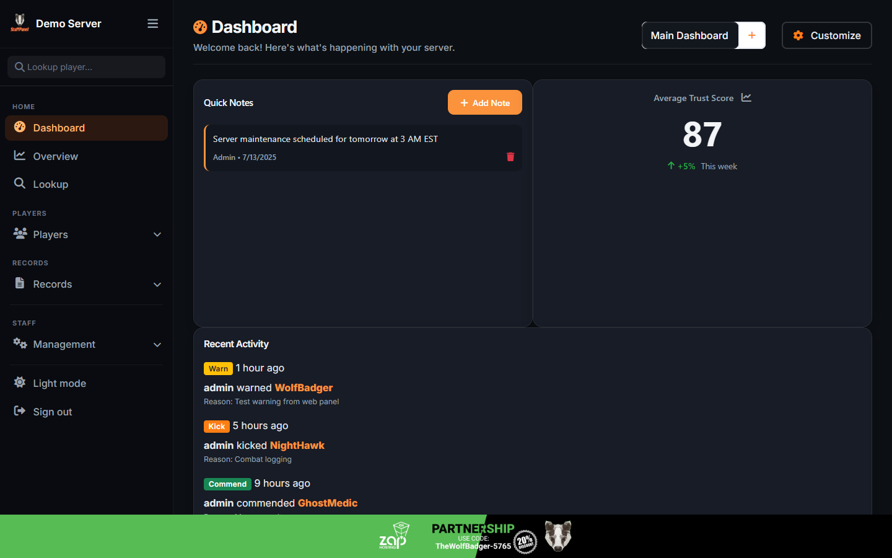
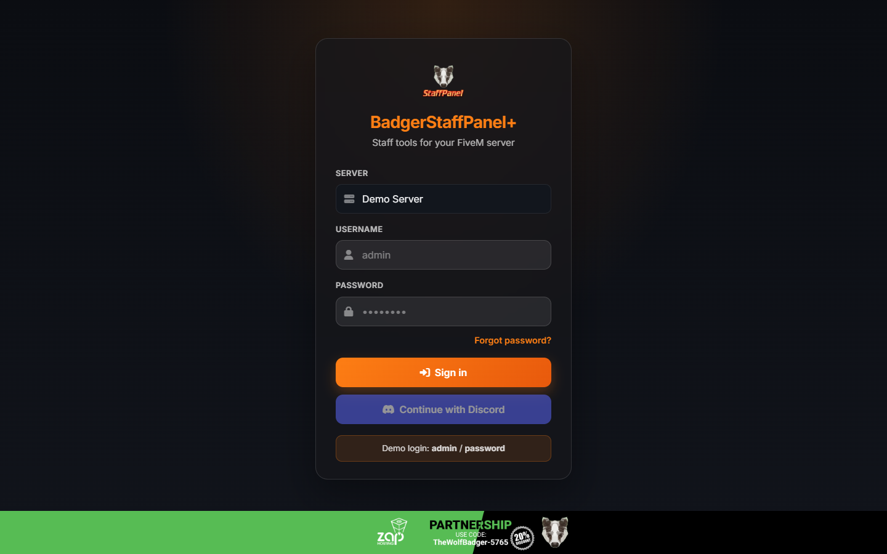
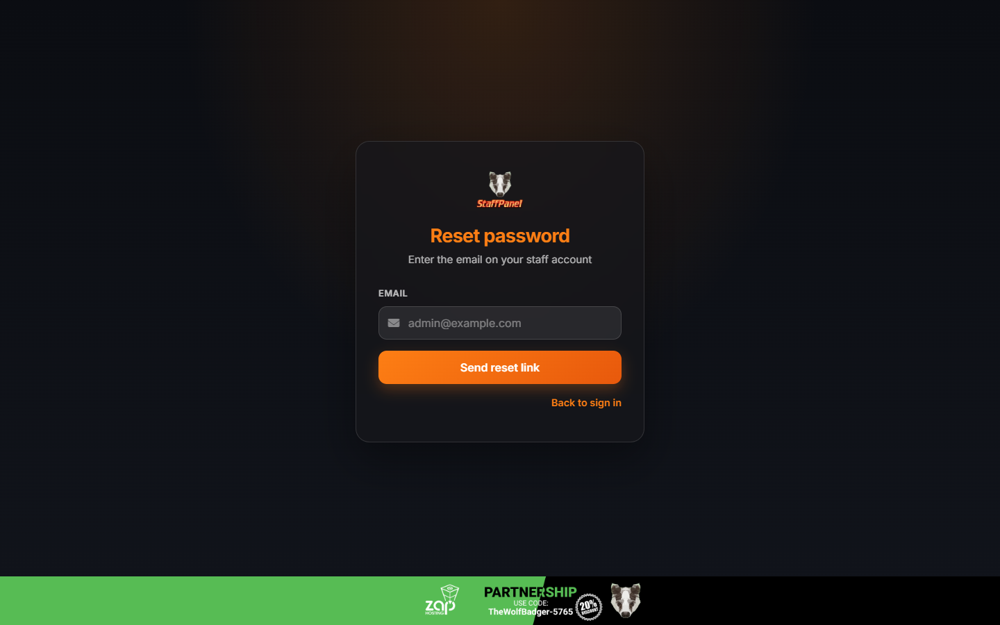
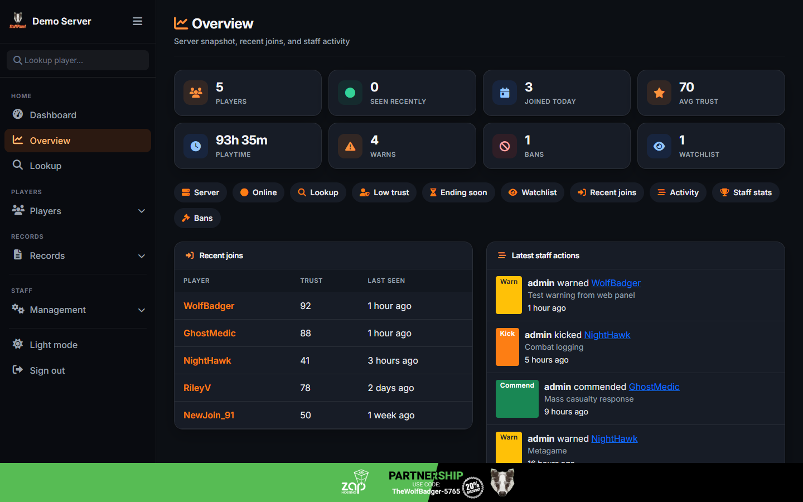
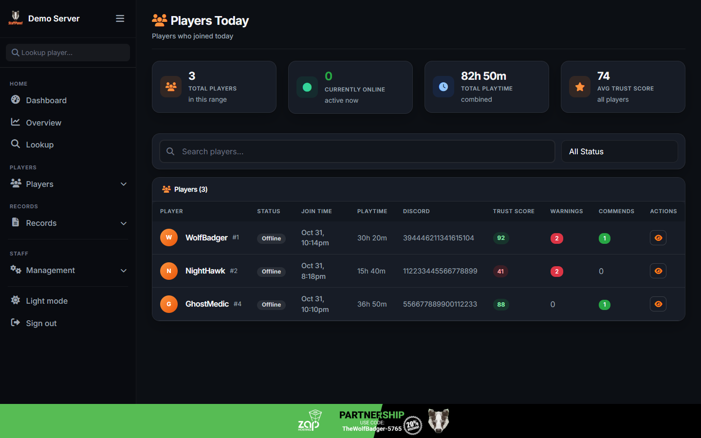
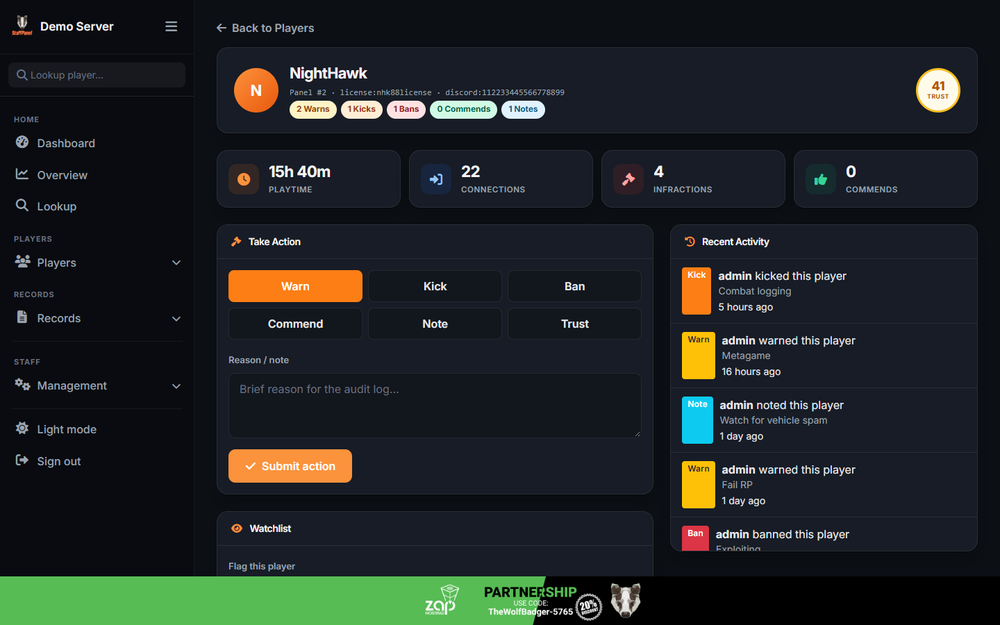
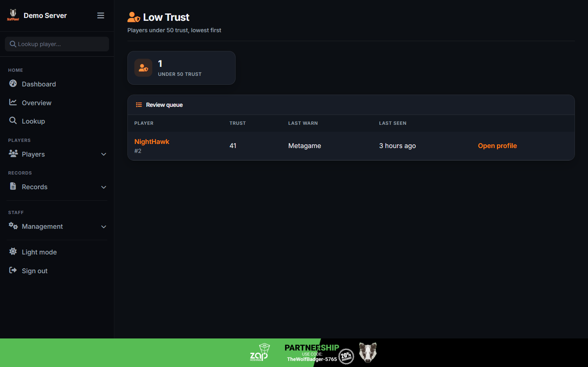
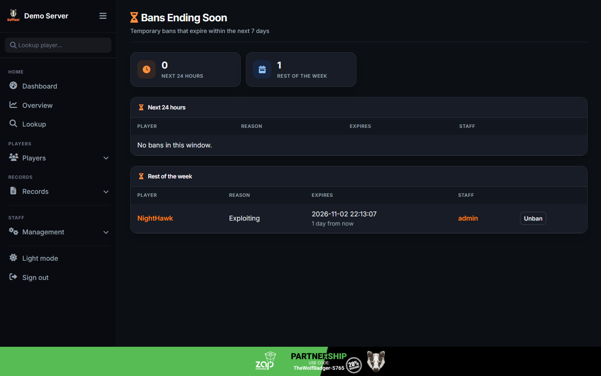
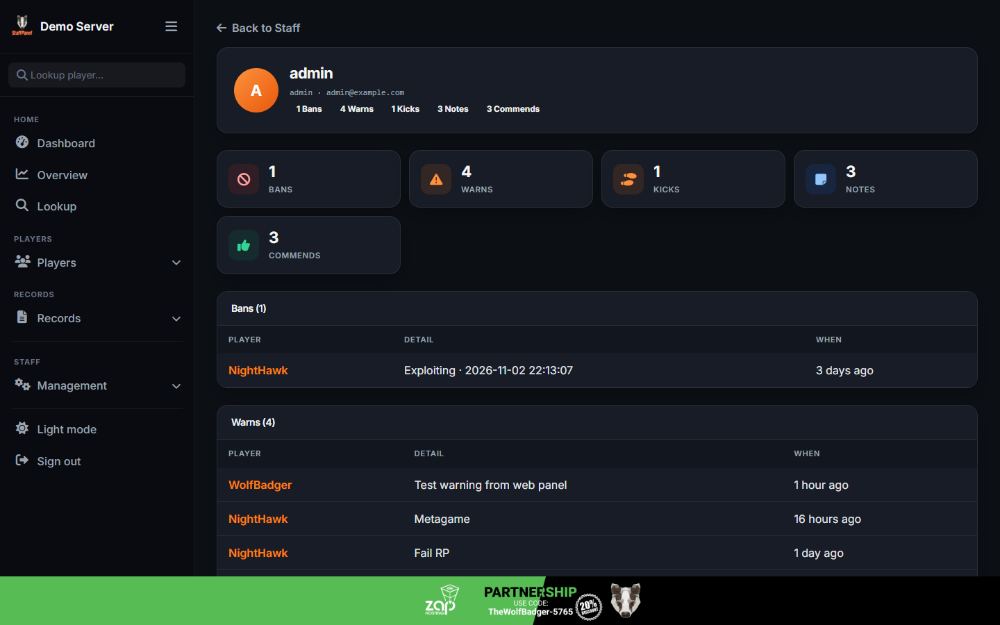

# BadgerStaffPanel+


## First-run installer

A fresh panel opens the web installer at `/web/install/welcome` instead of the login page. It walks through:

1. Server requirements
2. Terms of Service
3. Application configuration
4. MySQL connection and migrations
5. First server + admin account
6. Optional Discord login / webhook
7. Finish and lock the installer

Existing databases that already have staff accounts are detected and skip the wizard.

## Demo login

Docker and `php artisan db:seed` create a dummy server and admin you can use immediately:

* **Server:** Demo Server
* **Username:** `admin`
* **Password:** `password`

## Run with Docker

Requires [Docker Desktop](https://www.docker.com/products/docker-desktop/) (or Docker Engine + Compose).

```bash
# Optional: copy env if you do not already have one
cp .env.example .env

# Build and start the app + MySQL
docker compose up -d --build
```

Open **http://localhost:8080/web**. On a new MySQL volume you will get the installer. Use host `mysql`, database `staffpanel_db`, user `staffpanel`, and password `secret` on the database step.

| Service | Host port | Notes |
|---------|-----------|--------|
| App (Apache/PHP 8.2) | `8080` | Override with `APP_PORT=3000 docker compose up -d` |
| MySQL 8 | `3306` | User `staffpanel` / password `secret`, DB `staffpanel_db` |

To reset the database and run the installer again:

```bash
docker compose down -v
rm -f storage/app/installed
docker compose up -d --build
```

Useful commands:

```bash
docker compose logs -f app
docker compose exec app php artisan about
docker compose down
```

Discord / captcha / API keys can be set in the installer, or in your shell / project `.env`. Compose forwards `MASTER_*`, `DISCORD_*`, and `GOOGLE_CAPTCHA_*` into the app container.

## Features
* Warning System
* Kick System
* Ban System
* Commend System
* TrustScore System
* Playtime System
* Panel Actions Logged
* Editable Personal Dashboard
* Dashboard Statistics
* Discord Based Permissions
* Full Discord Logging
* Bootstrap v5

## Simple Documentation
### Endpoints
`/views/api` => Home of the views provided for the `/api` endpoint

`/views/login` => Home of the views provided for the default `/web` endpoints

`/views/verified` => Home of the views provided for `/web/verified` endpoints
### Middleware
Coming Soon
### Navigation
* Dashboard
* Records
  * Commends
  * Warns
  * Kicks
  * Bans
  * TrustScores
* Players
  * Players Today
  * Weekly Players
  * Monthly Players
  * All Players
* Management
  * Manage Staff
  * Manage Tokens
  * Settings
  * Sign Out

### Widgets
* widget_commends
* widget_warns
* widget_kicks
* widget_bans
* widget_trustscores
* widget_records
* widget_players_today
* widget_weekly_players
* widget_monthly_players
* widget_all_players

## Permissions via token
* Registry
  * Register player into StaffPanel system
* Staff
  * Create
  * Delete
* Bans
  * Create
  * Delete
* Kicks
  * Create
  * Delete
* Warns
  * Create
  * Delete
* Commends
  * Create
  * Delete
* Notes
  * Create
  * Delete
* TrustScores
  * Create
  * Delete
  * Reset

## Screenshots
### Sign in



### Overview


### Players




### Records



### Staff

